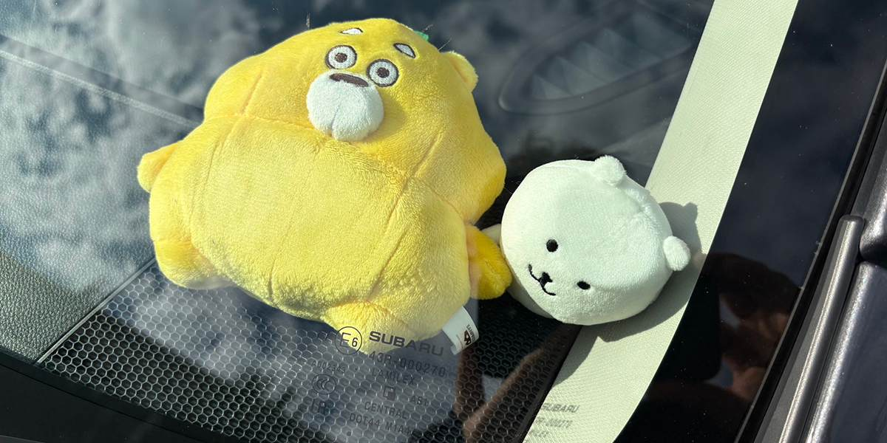
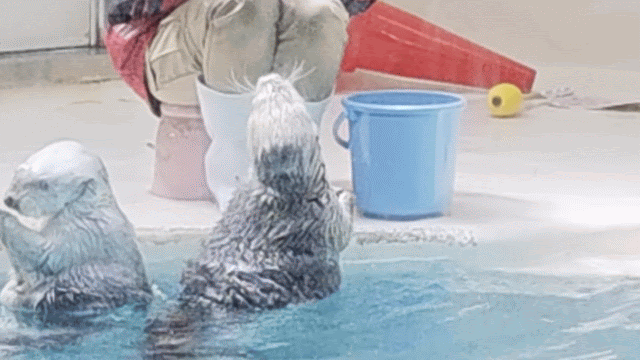
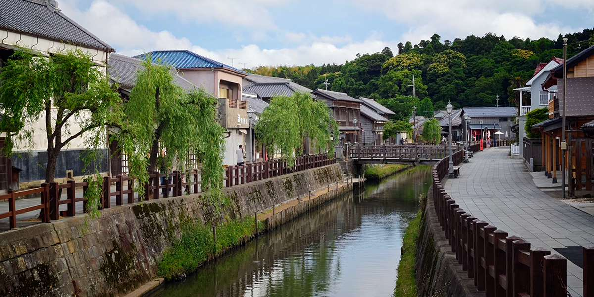
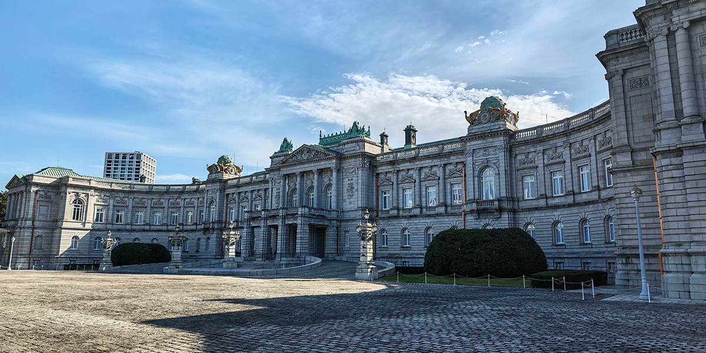

import EmbedCard from '@/components/Blog/EmbedCard.astro';

Last year: [Best Buy 2025](/blog/2025-best-buy)

Why am I publishing this in November? Because I wanted to get it out in time for [Amazon Black Friday](https://www.amazon.co.jp/?tag=psephopaiktes-22). And yes, this post contains affiliate links.

---

## Gadgets

I did not buy many gadgets this year, but I changed my portable power setup.

### [Xiaomi UltraThin Battery](https://www.amazon.co.jp/dp/B0FX4WXTJJ?tag=psephopaiktes-22) + [CIO NovaPort SLIM DUOII 45W](https://link.amazon/B0a6Rm48P) ★★★

For a long time, I used an [Anker 521 Power Bank](https://www.amazon.co.jp/dp/B0B4GVLW6D), which doubles as a 45W wall charger and a 5,000mAh battery. A proper successor that could also charge a laptop never showed up, so I decided to carry two separate items instead:

* A slim MagSafe-compatible power bank
* A slim wall charger

The combined setup is actually lighter, and it is more convenient too. I am very happy with the switch.

<EmbedCard
    url="https://www.amazon.co.jp/dp/B0FX4WXTJJ?tag=psephopaiktes-22"
    img="https://m.media-amazon.com/images/I/41cw38wlq3L._AC_SL1500_.jpg"
    title="Amazon | Xiaomi UltraThin 5,000mAh Power Bank, 6mm Slim, MagSafe-Compatible Wireless Charging for iPhone"
    site="amazon.co.jp" />

<EmbedCard
    url="https://www.amazon.co.jp/dp/B0H3278SLM?tag=psephopaiktes-22"
    img="https://m.media-amazon.com/images/I/61t0Nb+j5wL._AC_SL1500_.jpg"
    title="Amazon.co.jp: CIO NovaPort SLIM DUOII 45W2C USB-C PD Fast Charger"
    site="amazon.co.jp" />

---

## Health and fitness

### [LOWYA Portable Blender](https://www.amazon.co.jp/dp/B0FGX43H9H?tag=psephopaiktes-22) ★★☆

<EmbedCard
    url="https://www.amazon.co.jp/dp/B0FGX43H9H?tag=psephopaiktes-22"
    img="https://m.media-amazon.com/images/I/61moTkz4awL._AC_SL1500_.jpg"
    title="Amazon.co.jp: LOWYA Portable USB Blender, White"
    site="amazon.co.jp" />

This is a USB-C rechargeable blender about the size of a water bottle. I used it constantly for smoothies made with frozen banana, avocado, and protein powder.

**Cleaning it is incredibly easy: just add water and dish soap, then press the button.**

### [inPROTEIN Unsweetened Café au Lait](https://www.amazon.co.jp/dp/B0GSCW5K3S?tag=psephopaiktes-22) ★★☆

<EmbedCard
    url="https://www.amazon.co.jp/dp/B0GSCW5K3S?tag=psephopaiktes-22"
    img="https://m.media-amazon.com/images/I/71B1byFgMRL._AC_SL1500_.jpg"
    title="Amazon.co.jp: Morinaga inPROTEIN Unsweetened Café au Lait, 12-Pack"
    site="amazon.co.jp" />

Most protein drinks are sweet, which can make them hard to drink depending on the occasion. This one tastes like a normal, unsweetened café latte, so it goes down easily. You can buy it at convenience stores too.

### [MEGALOS UCC Protein Coffee](https://www.amazon.co.jp/dp/B0D6TPD2J7?tag=psephopaiktes-22) ★★★

<EmbedCard
    url="https://www.amazon.co.jp/dp/B0D6TPD2J7?tag=psephopaiktes-22"
    img="https://m.media-amazon.com/images/I/61vnB1Kwi0L._AC_SL1000_.jpg"
    title="Amazon.co.jp: MEGALOS UCC Unsweetened Protein Coffee, 30 Sticks"
    site="amazon.co.jp" />

This one is also unsweetened and tastes like ordinary instant coffee. I may like it even more because it can be stored at room temperature and takes up hardly any space.

### [Weighted Pull-Up Belt](https://www.amazon.co.jp/dp/B08GHHNGRX?tag=psephopaiktes-22) ★☆☆

<EmbedCard
    url="https://www.amazon.co.jp/dp/B08GHHNGRX?tag=psephopaiktes-22"
    img="https://m.media-amazon.com/images/I/71m-I+--rrL._AC_SL1500_.jpg"
    title="Amazon | Smilerain Weighted Pull-Up and Dip Belt with Adjustable Chain"
    site="amazon.co.jp" />

Once I could comfortably do around 15 pull-ups or dips, I started adding weight. I do not think the brand matters much for this one.

---
## Kitchen

### [Microwave Hot Sandwich Maker](https://www.amazon.co.jp/dp/B0GGYZV9X3?tag=psephopaiktes-22) ★★★

<EmbedCard
    url="https://www.amazon.co.jp/dp/B0GGYZV9X3?tag=psephopaiktes-22"
    img="https://m.media-amazon.com/images/I/71bJKcImOGL._AC_SL1500_.jpg"
    title="Amazon | Microwave Hot Sandwich Maker with Nonstick Coating"
    site="amazon.co.jp" />

I love hot sandwiches, but I rarely made them because the press was heavy and awkward to wash in the dishwasher. Since getting this microwave version, I can make one whenever I want. It tastes properly good, and it works without adding oil.

### [TrendPlain Oil Sprayer](https://www.amazon.co.jp/dp/B0D54PM77N?tag=psephopaiktes-22) ★★☆

<EmbedCard
    url="https://www.amazon.co.jp/dp/B0D54PM77N?tag=psephopaiktes-22"
    img="https://m.media-amazon.com/images/I/71C8hovgEjL._AC_SL1500_.jpg"
    title="Amazon.co.jp: TrendPlain 470ml 2-in-1 Oil Sprayer and Dispenser"
    site="amazon.co.jp" />

An oil sprayer is a classic dieting tool for cutting down how much oil you use.

* Light-blocking glass
* Both a spray nozzle and a pouring spout

Surprisingly few products met both requirements, so I chose this one.

---

## Cycling
### [CAMELBAK Podium](https://www.amazon.co.jp/dp/B0CJSHPHKG?tag=psephopaiktes-22) ★★★

<EmbedCard
    url="https://www.amazon.co.jp/dp/B0CJSHPHKG?tag=psephopaiktes-22"
    img="https://m.media-amazon.com/images/I/51VlrtKct-L._AC_SL1500_.jpg"
    title="Amazon | CAMELBAK Podium Stainless Steel Vacuum-Insulated Cycling Bottle, 530ml"
    site="amazon.co.jp" />

I wanted a bottle with better insulation, so I bought this one. It looks great, is dishwasher-safe, and is easy to drink from. I use it not only on my bike, but also as my everyday water bottle and at the gym.

There is also a lighter [titanium model](https://link.amazon/B06ntyT7p), but stainless steel is more than enough for me.

### [BBB WHELFIXED](https://www.amazon.co.jp/dp/B000VSWH70?tag=psephopaiktes-22) ★★☆

<EmbedCard
    url="https://www.amazon.co.jp/dp/B000VSWH70?tag=psephopaiktes-22"
    img="https://m.media-amazon.com/images/I/51UB2aZ6yML._AC_SL1327_.jpg"
    title="Amazon.co.jp: BBB BQR-03 WHELFIXED Axle Skewers"
    site="amazon.co.jp" />

These axle skewers replace quick-release levers, so the wheels cannot be removed without a hex key. I bought them to deter wheel theft, and they make the bike look cleaner too.

I previously used an even more secure [set that requires a dedicated tool](https://link.amazon/B09YhHt0J), but it made train travel with the bike and maintenance slightly annoying, so I stopped using it.

---

## Car-related items

### [Speedo Micro Chamois Towel](https://www.amazon.co.jp/dp/B0834T173B?tag=psephopaiktes-22) ★★★

<EmbedCard
    url="https://www.amazon.co.jp/dp/B0834T173B?tag=psephopaiktes-22"
    img="https://m.media-amazon.com/images/I/81diqnDS6dL._AC_SL1500_.jpg"
    title="Amazon | Speedo Micro Chamois Towel, Size M"
    site="amazon.co.jp" />

I **highly recommend this to just about everyone**. A chamois towel is mainly used at swimming pools and can be wrung out and reused immediately. Pairing one with a normal face towel is my ideal setup for travel, public baths, and pools.

At a public bath or pool, you can dry almost your entire body with this before stepping into the changing room.

I had already been using one, but bought another to keep permanently in the car. There are also [types that become stiff when dry](https://link.amazon/B0aOBFdoe). They absorb more water, but they are bulky and do not feel great against the skin, so I recommend the soft type.

### [Ultra-Compact Car Charger](https://www.amazon.co.jp/dp/B0CZ791JGH?tag=psephopaiktes-22) ★★☆

<EmbedCard
    url="https://www.amazon.co.jp/dp/B0CZ791JGH?tag=psephopaiktes-22"
    img="https://m.media-amazon.com/images/I/51zjK75eFkL._AC_SL1500_.jpg"
    title="Amazon.co.jp: NUIKOTI Ultra-Compact USB &amp; USB-C Car Charger, PD30W + QC3.0"
    site="amazon.co.jp" />

It sits almost flush with the socket, which is great.

### [Franklin Sports Spill-Proof Pet Bowl](https://www.amazon.co.jp/dp/B07JQBXPLJ?tag=psephopaiktes-22) ★☆☆

<EmbedCard
    url="https://www.amazon.co.jp/dp/B07JQBXPLJ?tag=psephopaiktes-22"
    img="https://m.media-amazon.com/images/I/71+0Od+rRjL._AC_SL1500_.jpg"
    title="Amazon | Franklin Sports Spill-Proof Travel Bowl for Dogs and Cats"
    site="amazon.co.jp" />

I bought this as a water bowl for sleeping in the car with my cat. It barely spills even while driving. Honestly, it is expensive, but I am glad I bought it. There really are not many good alternatives.

Cheaper floating-disk bowls exist, but they look harder to drink from and take up more space.

---

## Entertainment, places, and more

### Various essay manga ★★☆

I love essay manga and read a lot of them. I am especially fond of memoirs about other people's slightly unusual lives.

<EmbedCard
    url="https://www.amazon.co.jp/dp/B07PY34BDN?tag=psephopaiktes-22"
    img="https://m.media-amazon.com/images/I/B1I0qO34-tS.SY300_.png"
    title="Amazon.co.jp: Tokachi Hitoribocchi Farm, Vol. 1 by Yuji Yokoyama"
    site="amazon.co.jp" />

This is an autobiographical manga about an artist who started—or was made to start—a farm in Tokachi. It has made me really want to visit Tokachi.

<EmbedCard
    url="https://www.amazon.co.jp/dp/B0H5WBVJ53?tag=psephopaiktes-22"
    img="https://m.media-amazon.com/images/W/BW_MEDIAX_AVIF_MEASUREMENT_1306696-T4/images/I/81NN6WFQahL._SL1500_.jpg"
    title="Amazon.co.jp: My Brother Is a Ninja—Except He Is Not by Megumi"
    site="amazon.co.jp" />

I started following this essay blogger this year. The author seems fairly normal, maybe, but the people around her are quite a cast and very entertaining. Her dieting manga, [Hōtō Dieter, Eating Again Today](https://ddnavi.com/houtou/), is also serialized for free on Da Vinci Web and is a fun read.

<EmbedCard
    url="https://www.amazon.co.jp/dp/B08ZC4FDXZ?tag=psephopaiktes-22"
    img="https://m.media-amazon.com/images/I/B1FuGVDJaML.SY300_.png"
    title="Amazon.co.jp: After Divorcing, I Ended Up Living in My Car by Ichiro Inoue"
    site="amazon.co.jp" />

This is an autobiographical manga by an artist who sold his house and now lives in a kei van. I only bought a car this year, but after trying a night of car camping under the influence of this manga, I now seriously want to switch to a kei van.

### [Spider-Man: Brand New Day](https://www.amazon.co.jp/gp/video/detail/B0H8P22Y7J) ★★★

<EmbedCard
    url="https://www.amazon.co.jp/gp/video/detail/B0H8P22Y7J"
    img="https://images-fe.ssl-images-amazon.com/images/S/pv-target-images/d1c2e61b50a89912fdcc5b98f6b3f1084df69a01dc5b98f5489a06bb25288ee4._UR1920,1080_SX899_FMavif_PQ65_.jpg"
    title="Amazon.co.jp: Watch Spider-Man: Brand New Day | Prime Video"
    site="amazon.co.jp" />

This was my number-one piece of entertainment this year. It brought back the excitement that made me love the MCU in the first place. The visuals, story, and characters are all fantastic!

### Hirokuma ★★☆

[[Official] Hirokuma | HIT Hiroshima Tourism Ambassador](https://hirokuma.site/#about)

*Hiroshima's bear and Nagano's bear*

My current favorite character is this bear from Hiroshima Prefecture. Honestly, the character design is not really my thing, and it can feel like an ordinary local mascot. But the occasional emotional video in my feed won me over. The illustrator has an incredible sense for this stuff.

<blockquote class="twitter-tweet">
💫 https://t.co/vu9rX6oWUa
&mdash; ひろくま (@hirokuma_1690) <a href="https://x.com/hirokuma_1690/status/1806643715429298559?ref_src=twsrc%5Etfw">June 28, 2024</a></blockquote>

### Toba Aquarium ★★★

[MAP](https://maps.app.goo.gl/1sDRJCiLvTaZwV3M6)

I had wanted to visit Ise and Toba for years and finally made it there. This is now the only place in Japan where you can see a sea otter in captivity. Sea otters are so calculatedly cute that they rival cats in sheer destructive power. For the details, please read [Heaven's Design Team, Vol. 3](https://link.amazon/B03NQNBCA).

Kira, one of the aquarium's sea otters, recently passed away, leaving Mei as the only sea otter kept in Japan. Mie Prefecture has no airport and is extremely far from Tokyo by either train or car, but Toba Aquarium is absolutely worth visiting.

### Sawara Merchant District, Chiba ★☆☆

[MAP](https://maps.app.goo.gl/ZHpi1T1m4rBFZGAcA)

This is one of Japan's so-called "Little Edo" districts. I recommend it if you like places such as Kawagoe, Kurashiki's Bikan Historical Quarter, or Okage Yokocho.

The [NIPPONIA Sawara Merchant Town Hotel](https://www.nipponia-sawara.jp/), created from renovated traditional houses and merchant buildings, is probably the best-known place to stay. It is expensive, but you might as well stay there. The hotel also appears in the first chapter of the manga [Hotel for One](https://link.amazon/B03BgFid0).

If you are driving, you can probably also visit [Katori Jingu](https://maps.app.goo.gl/hDUQ2bySchFzcuG37) and [Ushiku Daibutsu](https://maps.app.goo.gl/xWQP5cSvFjJ6GsGx9). I stayed in Sawara while cycling the route around Lake Kasumigaura.

### Akasaka Palace ★★★

[MAP](https://maps.app.goo.gl/c6VpmJjhLuM6ohkS6)

Akasaka Palace is an **active** Western-style palace managed by the Cabinet Office to receive state guests. It is unquestionably several levels above the many Western-style buildings around Tokyo and Japan that are now tourist attractions after serving their original purpose.

> [About Akasaka Palace | Cabinet Office](https://www.geihinkan.go.jp/akasaka/about/) Built in 1909 as the Crown Prince's Residence, this National Treasure is still used as Japan's State Guest House today.

* Security screening is strict
* Admission is expensive—around ¥2,000
* <b>There are no restrooms inside the palace, and photography is prohibited</b>
* It is only open to the public on [selected dates](https://www.geihinkan.go.jp/akasaka/visit/visit_calendar/)

Those conditions make visiting a bit demanding, but it is absolutely worthwhile. There are hardly any shops, though afternoon tea is sometimes served in front of the palace.
