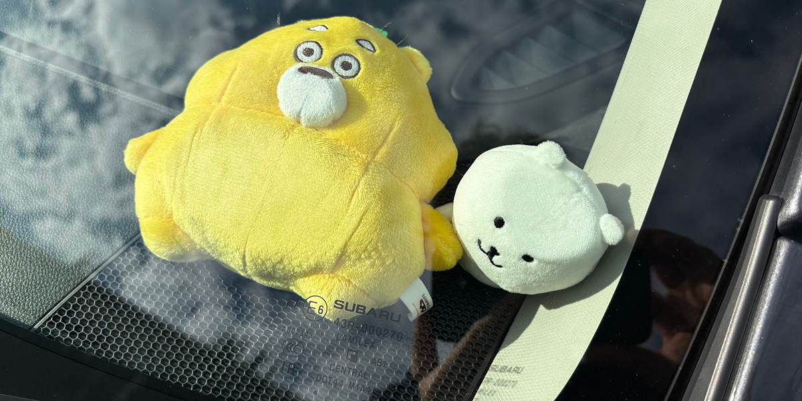
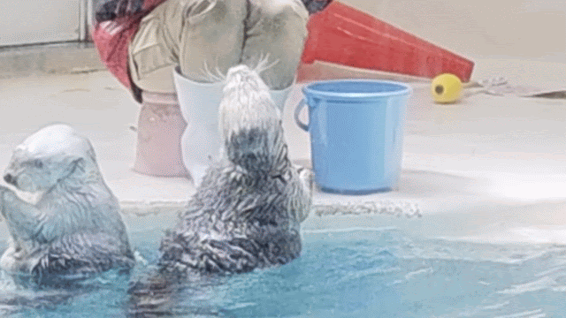
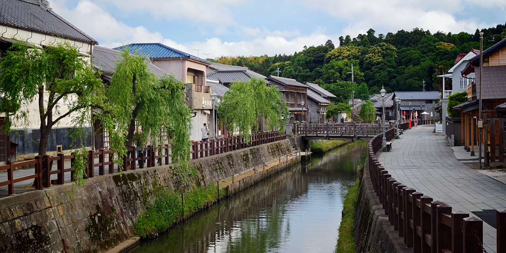
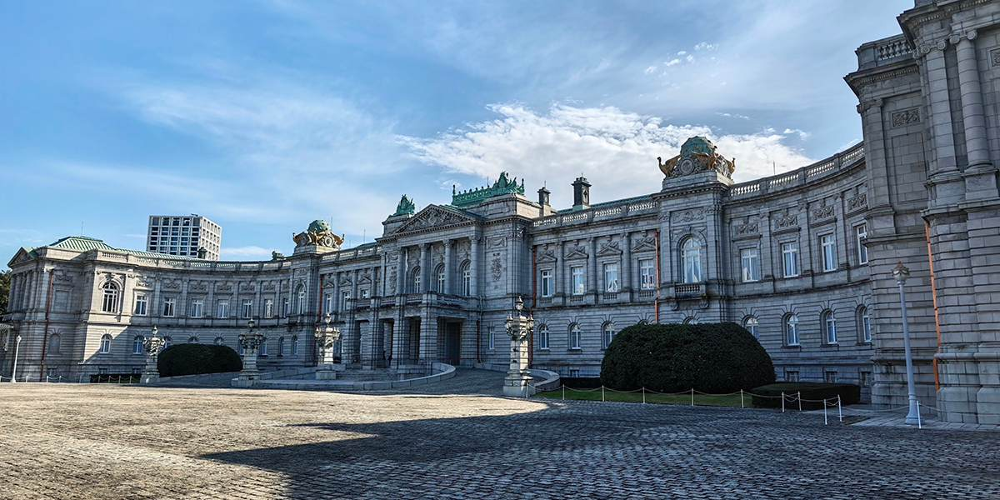

import EmbedCard from '@/components/Blog/EmbedCard.astro';

去年: [Best Buy 2025](/blog/2025-best-buy)

なぜ11月に書いているかと言うと、[Amazonブラックフライデー](https://www.amazon.co.jp/?tag=psephopaiktes-22)に合わせたいからです。※このブログ記事はもちろんアフィリンクを含みます。

---

## ガジェット系

今年はあんまり買ってないですが、モババの構成を変えました。

### [Xiaomi UltraThinバッテリー](https://www.amazon.co.jp/dp/B0FX4WXTJJ?tag=psephopaiktes-22) + [CIO NovaPort SLIM DUOII 45W](https://link.amazon/B0a6Rm48P) ★★★

長らくACアダプタ45Wと5000mAhバッテリーを兼用できる[Anker 521 Power Bank](https://www.amazon.co.jp/dp/B0B4GVLW6D)を愛用していたのですが、なかなかPCにも使える後継機が出なかったので、

* 薄型MagSafeモバイルバッテリー
* 薄型ACアダプタ

を2つ持ち歩くことにしました。結果的に物量は軽くなったし使い勝手もいいので満足です。

<EmbedCard
    url="https://www.amazon.co.jp/dp/B0FX4WXTJJ?tag=psephopaiktes-22"
    img="https://m.media-amazon.com/images/I/41cw38wlq3L._AC_SL1500_.jpg"
    title="Amazon | Xiaomi シャオミ UltraThin モバイルバッテリー 5000mAh 6mm薄型 magsafe ワイレス充電 iPhone対応 PSE認証 | 6mm極薄 98g軽量 小型 コンパクト USB-Cポート最大22.5W出力 ワイヤレス最大15W出力 iPhone最大7.5W出力 MagSafe対応 マグセーフ マグネット式 インジケーターライト残量表示 NTC温度制御 | Xiaomi | モバイルバッテリー"
    site="amazon.co.jp" />

<EmbedCard
    url="https://www.amazon.co.jp/dp/B0H3278SLM?tag=psephopaiktes-22"
    img="https://m.media-amazon.com/images/I/61t0Nb+j5wL._AC_SL1500_.jpg"
    title="Amazon.co.jp: CIO NovaPort SLIM DUOII 45W2C PD急速充電器 USB-C×2 180°スイングプラグ 薄型軽量70g (ブラック) | 急速充電 2ポート 薄型 軽量 PD PPS NovaIntelligence ノートPC iPhone Switch2向け : パソコン・周辺機器"
    site="amazon.co.jp" />

---

## 健康・筋トレ関連

### [LOWYA ポータブルミキサー](https://www.amazon.co.jp/dp/B0FGX43H9H?tag=psephopaiktes-22) ★★☆

<EmbedCard
    url="https://www.amazon.co.jp/dp/B0FGX43H9H?tag=psephopaiktes-22"
    img="https://m.media-amazon.com/images/I/61moTkz4awL._AC_SL1500_.jpg"
    title="Amazon.co.jp : LOWYA ロウヤ ミキサー ブレンダー ミル ポータブルミキサー ホワイト | ジューサー 小型 スムージー 氷も砕ける 持ち運べる 離乳食 フードプロセッサー コードレス USB充電 軽量 丸洗いOK : ホーム＆キッチン"
    site="amazon.co.jp" />

Type-Cで使える水筒サイズのジューサーです。切って凍らせたバナナやアボカドとプロテインパウダーでスムージー作るのに多用しました。

**使用後も水と洗剤を入れてボタンを押せば洗浄完了する**のが超ラクです。

### [inPROTEIN 甘くないカフェオレ](https://www.amazon.co.jp/dp/B0GSCW5K3S?tag=psephopaiktes-22) ★★☆

<EmbedCard
    url="https://www.amazon.co.jp/dp/B0GSCW5K3S?tag=psephopaiktes-22"
    img="https://m.media-amazon.com/images/I/71B1byFgMRL._AC_SL1500_.jpg"
    title="Amazon.co.jp: [冷蔵] 森永乳業 inPROTEIN(インプロテイン) 甘くないカフェオレ 1ケース （12本) プロテイン タンパク質 甘味料不使用 | ドリンク プロテインドリンク 飲み物 1本330mlでプロテイン20gが摂取可能なプロテインドリンク : 食品・飲料・お酒"
    site="amazon.co.jp" />

プロテインドリンク系は甘いものが多くてタイミング的に飲みづらい場合が多いですが、これは普通にカフェラテ味で甘くないので飲みやすいです。コンビニで買えます。

### [メガロス UCC プロテインコーヒー](https://www.amazon.co.jp/dp/B0D6TPD2J7?tag=psephopaiktes-22) ★★★

<EmbedCard
    url="https://www.amazon.co.jp/dp/B0D6TPD2J7?tag=psephopaiktes-22"
    img="https://m.media-amazon.com/images/I/61vnB1Kwi0L._AC_SL1000_.jpg"
    title="Amazon.co.jp: メガロス UCC プロテインコーヒー スティックタイプ 30本入り 1本7.5g たんぱく質6.1g 無糖 : 食品・飲料・お酒"
    site="amazon.co.jp" />

こちらも同じく、甘くなくてふつうにインスタントコーヒー味です。こっちのほうが常温保存できてかさばらないので好きかも。

### [懸垂 加重ベルト](https://www.amazon.co.jp/dp/B08GHHNGRX?tag=psephopaiktes-22) ★☆☆

<EmbedCard
    url="https://www.amazon.co.jp/dp/B08GHHNGRX?tag=psephopaiktes-22"
    img="https://m.media-amazon.com/images/I/71m-I+--rrL._AC_SL1500_.jpg"
    title="Amazon | Smilerain 懸垂 ベルト 加重ベルト ディプスベルト ディッピングベルト トレーニングベルト 耐久性 付け心地が良い チェーンの長さ調節できる 丈夫で使いやすい | Smilerain | トレーニングベルト"
    site="amazon.co.jp" />

懸垂やディップスが普通に15回くらいできるようになったので、荷重するようにしました。メーカーはどれでもいいと思います。

---
## キッチン関連

### [電子レンジ専用ホットサンドメーカー](https://www.amazon.co.jp/dp/B0GGYZV9X3?tag=psephopaiktes-22) ★★★

<EmbedCard
    url="https://www.amazon.co.jp/dp/B0GGYZV9X3?tag=psephopaiktes-22"
    img="https://m.media-amazon.com/images/I/71bJKcImOGL._AC_SL1500_.jpg"
    title="Amazon | 電子レンジ専用ホットサンドメーカー 電子レンジ調理器 フッ素コーティング アルミメッキ鋼材 シリコン 1台多役 焦げ目 175x155x35mm 丸洗い可能サンド焼き 丸洗い可能 レシピと日本語取り扱い説明書付きサンドメーカー レンジでサンド焼き フッ素コーテイング 丸洗い可能 レシピと日本語取り扱い説明書付き 一人暮らし 初心者向け 一人暮らし 初心者向け | Aionios | 電子レンジ調理用品"
    site="amazon.co.jp" />

ホットサンド好きなのですが、重い・食洗機で洗いづらいのであんまり作りませんでした。このレンジで作れるやつ導入してからはいつでも食べたい時に作れます。味もちゃんと美味しいし、油を敷かなくても作れます。

### [TrendPlain オイルスプレー](https://www.amazon.co.jp/dp/B0D54PM77N?tag=psephopaiktes-22) ★★☆

<EmbedCard
    url="https://www.amazon.co.jp/dp/B0D54PM77N?tag=psephopaiktes-22"
    img="https://m.media-amazon.com/images/I/71C8hovgEjL._AC_SL1500_.jpg"
    title="Amazon.co.jp: TrendPlain 470ml オイルスプレー 料理用 - 遮光・貼付けシール付き 2イン1 スプレーボトル＆ディスペンサー 油スプレー ブラック : ホーム＆キッチン"
    site="amazon.co.jp" />

ダイエッターに定番、油の量を減らすためのオイルスプレーです。

* 遮光ガラス
* スプレーと注ぎ口の両方使える

の条件を満たしたやつはなかなか少ないのでこれを選びました。

---

## 自転車関連
### [CAMELBAK ポディウム](https://www.amazon.co.jp/dp/B0CJSHPHKG?tag=psephopaiktes-22) ★★★

<EmbedCard
    url="https://www.amazon.co.jp/dp/B0CJSHPHKG?tag=psephopaiktes-22"
    img="https://m.media-amazon.com/images/I/51VlrtKct-L._AC_SL1500_.jpg"
    title="Amazon | CAMELBAK(キャメルバック) 自転車ボトル 真空断熱 長時間保冷 ポディウム ステンレス 530ml メタル | CamelBak | ボトル"
    site="amazon.co.jp" />

保冷力の高いボトルがほしいなあと思って購入。見た目もかっこよく食洗機でも使え、飲みやすいので満足。チャリだけではなく普段の水筒・ジム用としても多用してます。

軽量な[チタンモデル](https://link.amazon/B06ntyT7p)もありますが、ステンレスで十分。

### [BBB WHELFIXED](https://www.amazon.co.jp/dp/B000VSWH70?tag=psephopaiktes-22) ★★☆

<EmbedCard
    url="https://www.amazon.co.jp/dp/B000VSWH70?tag=psephopaiktes-22"
    img="https://m.media-amazon.com/images/I/51UB2aZ6yML._AC_SL1327_.jpg"
    title="Amazon.co.jp: BBB(ビービービー) BQR-03 WHELFIXED ホイールフィックス 524890 BQR-03 : スポーツ＆アウトドア"
    site="amazon.co.jp" />

クイックリリース(手動で外せる)ホイールを六角レンチがないと外せないようにする車軸です。ホイール盗難を防ぐために購入。見た目もよくなって最高です。

さらに防犯力が高い[専用工具が無いと外せないタイプ](https://link.amazon/B09YhHt0J)も使っていたのですが、輪行やメンテが少し面倒になったのでやめました。

---

## 自動車関連

### [Speedo Micro セームタオル](https://www.amazon.co.jp/dp/B0834T173B?tag=psephopaiktes-22) ★★★

<EmbedCard
    url="https://www.amazon.co.jp/dp/B0834T173B?tag=psephopaiktes-22"
    img="https://m.media-amazon.com/images/I/81diqnDS6dL._AC_SL1500_.jpg"
    title="Amazon | Speedo(スピード) タオル Micro セームタオル マイクロセームタオル M 水泳 ユニセックス SE62003 グレイ M | 吸水速度約3倍、乾いても硬くなりにくい抗菌セームタオル 持ちやすいカラビナ外掛け収納(ボトルあり対応) | Speedo(スピード) | スポーツタオル"
    site="amazon.co.jp" />

**万人に超オススメ**です。セームタオルとは主にプールで使われる、絞ったらすぐまた使えるタオルなのですが、これ+普通のフェイスタオルの組み合わせが旅行や銭湯・プール用のボディタオルとして最適解です。

大衆浴場やプールにこのセームタオルを持ち込めば、脱衣場に上がる前にこれだけでほぼすべて体が拭けます。

以前から使っていたのですが、車に乗せっぱなしにするために買い足しました。セームタオルは[乾くと固くなるタイプ](https://link.amazon/B0aOBFdoe)もありそちらのほうが吸水力は高いのですが、けっこう邪魔で肌触りも悪いので柔らかいタイプの方がオススメです。

### [極小 シガーソケットチャージャー](https://www.amazon.co.jp/dp/B0CZ791JGH?tag=psephopaiktes-22) ★★☆

<EmbedCard
    url="https://www.amazon.co.jp/dp/B0CZ791JGH?tag=psephopaiktes-22"
    img="https://m.media-amazon.com/images/I/51zjK75eFkL._AC_SL1500_.jpg"
    title="Amazon.co.jp: 【極小】シガーソケット USB &amp; USB-C カーチャージャー【 PD30W+QC3.0/急速充電/全金属】NUIKOTI Type C カーチャージャー 12V/24V車対応 出っ張らない しがーソケット USB 車載充電器 対応iPhone &amp; Android &amp; iPad,ダークグレー : 家電＆カメラ"
    site="amazon.co.jp" />

でっぱらなくて良いです。

### [Franklin Sports こぼれ防止ペットボウル](https://www.amazon.co.jp/dp/B07JQBXPLJ?tag=psephopaiktes-22) ★☆☆

<EmbedCard
    url="https://www.amazon.co.jp/dp/B07JQBXPLJ?tag=psephopaiktes-22"
    img="https://m.media-amazon.com/images/I/71+0Od+rRjL._AC_SL1500_.jpg"
    title="Amazon | Franklin Sports こぼれ防止ペットボウル - 水はねなし 旅行用水 + 犬+猫用フードディッシュ - 車用ポータブルペットボウル + 旅行用 - 16オンス - BPAフリー グレー | Franklin Sports | 食器・ボウル 通販"
    site="amazon.co.jp" />

ネコと車中泊するときの水皿として買いました。運転中もほとんど水が溢れません。正直値段が高いんですけど、買ってよかったです。他にいい商品ないんですよね。

フロート式の安いのとかもありますけど、飲みづらそうですしかさばります。

---

## コンテンツ・場所など

### エッセイ漫画いろいろ ★★☆

エッセイ漫画が好きなのでよく読みます。他人のすこし特殊な生活系の体験記が大好きです。

<EmbedCard
    url="https://www.amazon.co.jp/dp/B07PY34BDN?tag=psephopaiktes-22"
    img="https://m.media-amazon.com/images/I/B1I0qO34-tS.SY300_.png"
    title="Amazon.co.jp: 十勝ひとりぼっち農園（１） (少年サンデーコミックススペシャル) eBook : 横山裕二: Kindleストア"
    site="amazon.co.jp" />

十勝で農家をはじめ(させられ)た漫画家さんのエッセイです。かなり十勝行きたくなってます。

<EmbedCard
    url="https://www.amazon.co.jp/dp/B0H5WBVJ53?tag=psephopaiktes-22"
    img="https://m.media-amazon.com/images/W/BW_MEDIAX_AVIF_MEASUREMENT_1306696-T4/images/I/81NN6WFQahL._SL1500_.jpg"
    title="Amazon.co.jp: うちの兄は忍者です※忍者ではない (コミックエッセイ) eBook : 恵水: Kindleストア"
    site="amazon.co.jp" />

今年からフォローした、エッセイブログ書いてる方です。御本人はわりと普通？なのですが周りの方々が濃くて面白いです。ダ・ヴィンチWebで無料連載されてる[放蕩ダイエッター、今日も食べる](https://ddnavi.com/houtou/)というダイエットマンガも面白いです。

<EmbedCard
    url="https://www.amazon.co.jp/dp/B08ZC4FDXZ?tag=psephopaiktes-22"
    img="https://m.media-amazon.com/images/I/B1FuGVDJaML.SY300_.png"
    title="Amazon.co.jp: ＃離婚して車中泊になりました (ソノラマ＋コミックス) eBook : 井上 いちろう: Kindleストア"
    site="amazon.co.jp" />

家を売り払って軽バンで生活されてる漫画家さんです。今年車買ったばかりなのですが、このマンガに影響されて車中泊してみた結果、かなり軽バンに乗り換えたくなってます。

### [スパイダーマン：ブランド・ニュー・デイ](https://www.amazon.co.jp/gp/video/detail/B0H8P22Y7J) ★★★

<EmbedCard
    url="https://www.amazon.co.jp/gp/video/detail/B0H8P22Y7J"
    img="https://images-fe.ssl-images-amazon.com/images/S/pv-target-images/d1c2e61b50a89912fdcc5b98f6b3f1084df69a01dc5b98f5489a06bb25288ee4._UR1920,1080_SX899_FMavif_PQ65_.jpg"
    title="Amazon.co.jp: スパイダーマン：ブランド・ニュー・デイを観る | Prime Video"
    site="amazon.co.jp" />

今年ベストワンコンテンツでした…。久々にMCUを大好きになったワクワク感を思い出しました。映像・ストーリー・キャラが最高です！

### ひろくま ★★☆

[【公式】ひろくま｜HITひろしま観光大使](https://hirokuma.site/#about)

*ヒロシマの熊とナガノの熊です*

いまの推しです。広島県の熊です。正直キャラデザあんま好きじゃないしなんてことないよくあるご当地キャラな気もするのですが、たまに流れてくるエモ動画に心を打たれて好きになりました。絵師さんのセンスが最高。

<blockquote class="twitter-tweet">
💫 https://t.co/vu9rX6oWUa
&mdash; ひろくま (@hirokuma_1690) <a href="https://x.com/hirokuma_1690/status/1806643715429298559?ref_src=twsrc%5Etfw">June 28, 2024</a></blockquote>

### 鳥羽水族館 ★★★

[MAP](https://maps.app.goo.gl/1sDRJCiLvTaZwV3M6)

以前からずっと行きたかった伊勢・鳥羽にやっと行きました。日本で飼育されてるラッコが見れるのはここだけです。ラッコは本当に生態があざとく、ネコに匹敵する破壊力を持っています。詳しくは[天地創造デザイン部 3巻](https://link.amazon/B03NQNBCA)をよんでください。

先日ラッコのキラちゃんが死に、とうとう日本で飼育されているラッコはメイちゃん1匹です…。三重県は空港が無く電車でも自動車でも東京からはすっごい遠いのですが、ぜひ行くべきです。

### 千葉県 佐原商家町 ★☆☆

[MAP](https://maps.app.goo.gl/ZHpi1T1m4rBFZGAcA)

いわゆる「小江戸」で川越・美観地区・おかげ横丁などの雰囲気が好きなひとにはおすすめ。

古民家や商家を改造した[佐原商家町ホテルNIPPONIA](https://www.nipponia-sawara.jp/)というのが有名で、高いですがそこに泊まりましょう。[おひとりさまホテル](https://link.amazon/B03BgFid0)というマンガの1話で紹介されてます。

車で行くなら[香取神宮](https://maps.app.goo.gl/hDUQ2bySchFzcuG37)・[牛久大仏](https://maps.app.goo.gl/xWQP5cSvFjJ6GsGx9)あたりは寄れるかな？ 私は霞ヶ浦のサイクリングロードついでに宿泊しました。

### 迎賓館赤坂離宮 ★★★

[MAP](https://maps.app.goo.gl/c6VpmJjhLuM6ohkS6)

赤坂離宮は国賓などを招くため内閣府が管理している**現役の**洋館です。都内・全国によくある<b>昔使われて今は観光地</b>な洋館とは間違いなく数段クオリティが違います。

> [迎賓館赤坂離宮について | 内閣府](https://www.geihinkan.go.jp/akasaka/about/) 1909年に東宮御所として建てられ、現在は国の迎賓施設として使われている国宝です

* セキュリティチェックが厳しい
* 入場料が高い（2,000円くらい）
* <b>建築内にはトイレが無い・撮影禁止</b>
* [公開日](https://www.geihinkan.go.jp/akasaka/visit/visit_calendar/)は限られてる

となかなか条件が厳しいのですが、行く価値はとても高いです。売店とかはほぼ皆無ですが、宮殿前でアフタヌーンティーがやってることもあるっぽい。
