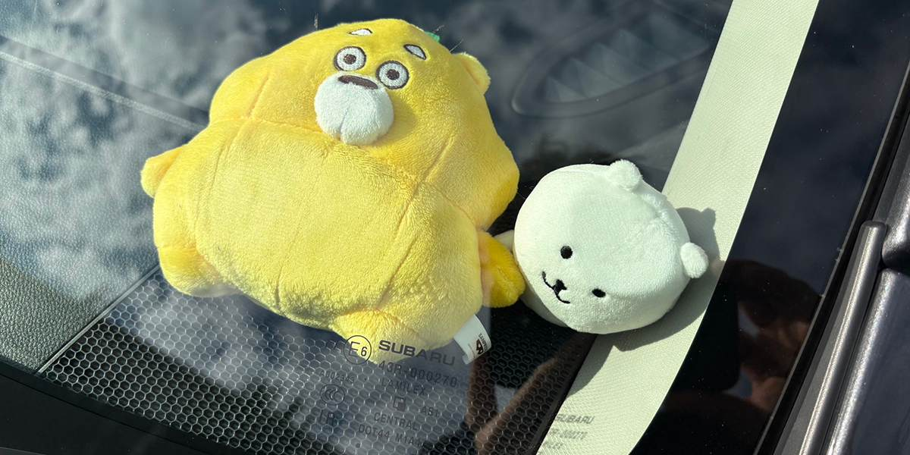
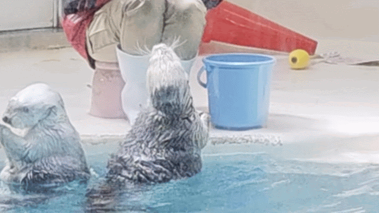
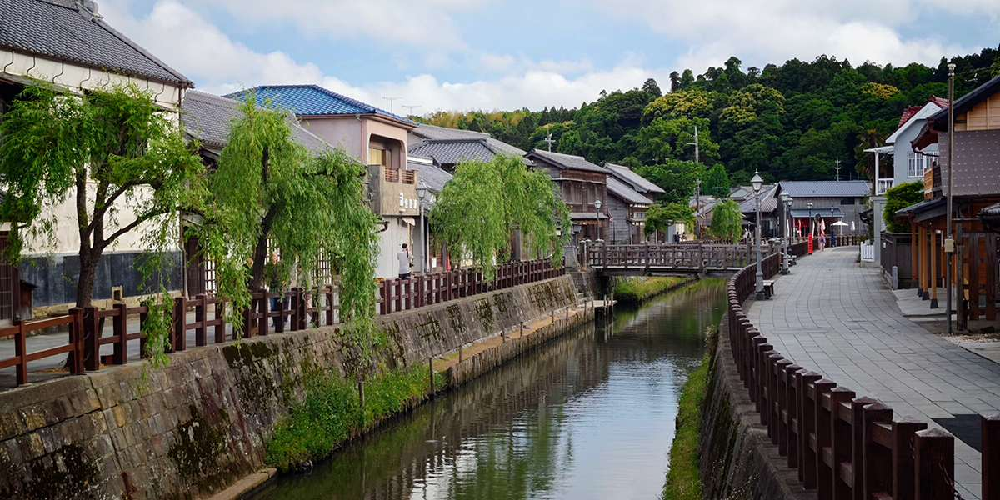
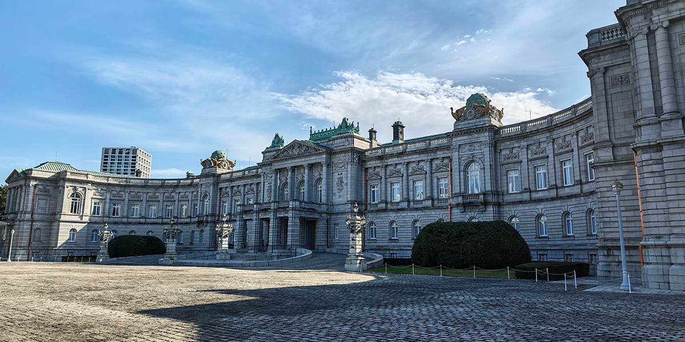

import EmbedCard from '@/components/Blog/EmbedCard.astro';

去年：[Best Buy 2025](/blog/2025-best-buy)

为什么要在 11 月写？因为想赶上 [Amazon 黑色星期五](https://www.amazon.co.jp/?tag=psephopaiktes-22)。当然，本文包含联盟营销链接。

---

## 数码产品

今年没买太多数码产品，不过调整了一下随身充电设备的组合。

### [Xiaomi UltraThin 充电宝](https://www.amazon.co.jp/dp/B0FX4WXTJJ?tag=psephopaiktes-22) + [CIO NovaPort SLIM DUOII 45W](https://link.amazon/B0a6Rm48P) ★★★

我长期使用 [Anker 521 Power Bank](https://www.amazon.co.jp/dp/B0B4GVLW6D)，它同时是一款 45W 充电器和 5000mAh 充电宝。但一直等不到一款也能给笔记本电脑充电的合适后继产品，于是改成随身携带两件设备：

* 超薄 MagSafe 充电宝
* 超薄充电器

结果整套设备反而更轻，用起来也更方便，我很满意。

<EmbedCard
    url="https://www.amazon.co.jp/dp/B0FX4WXTJJ?tag=psephopaiktes-22"
    img="https://m.media-amazon.com/images/I/41cw38wlq3L._AC_SL1500_.jpg"
    title="Amazon | Xiaomi UltraThin 5000mAh 超薄 MagSafe 兼容无线充电宝"
    site="amazon.co.jp" />

<EmbedCard
    url="https://www.amazon.co.jp/dp/B0H3278SLM?tag=psephopaiktes-22"
    img="https://m.media-amazon.com/images/I/61t0Nb+j5wL._AC_SL1500_.jpg"
    title="Amazon.co.jp: CIO NovaPort SLIM DUOII 45W2C USB-C PD 快充充电器"
    site="amazon.co.jp" />

---

## 健康与健身

### [LOWYA 便携搅拌杯](https://www.amazon.co.jp/dp/B0FGX43H9H?tag=psephopaiktes-22) ★★☆

<EmbedCard
    url="https://www.amazon.co.jp/dp/B0FGX43H9H?tag=psephopaiktes-22"
    img="https://m.media-amazon.com/images/I/61moTkz4awL._AC_SL1500_.jpg"
    title="Amazon.co.jp: LOWYA 便携式 USB 充电搅拌机 白色"
    site="amazon.co.jp" />

这是一款支持 Type-C 充电、水杯大小的榨汁机。我经常用它把切好冷冻的香蕉、牛油果和蛋白粉打成奶昔。

**用完后加水和洗涤剂，再按一下按钮就能洗干净**，实在太省事了。

### [inPROTEIN 无糖咖啡欧蕾](https://www.amazon.co.jp/dp/B0GSCW5K3S?tag=psephopaiktes-22) ★★☆

<EmbedCard
    url="https://www.amazon.co.jp/dp/B0GSCW5K3S?tag=psephopaiktes-22"
    img="https://m.media-amazon.com/images/I/71B1byFgMRL._AC_SL1500_.jpg"
    title="Amazon.co.jp: 森永乳业 inPROTEIN 无糖咖啡欧蕾 12 瓶装"
    site="amazon.co.jp" />

蛋白饮料大多偏甜，有些时候不太好入口。这款喝起来就是普通的无糖拿铁，很容易喝，而且便利店也能买到。

### [MEGALOS UCC 蛋白咖啡](https://www.amazon.co.jp/dp/B0D6TPD2J7?tag=psephopaiktes-22) ★★★

<EmbedCard
    url="https://www.amazon.co.jp/dp/B0D6TPD2J7?tag=psephopaiktes-22"
    img="https://m.media-amazon.com/images/I/61vnB1Kwi0L._AC_SL1000_.jpg"
    title="Amazon.co.jp: MEGALOS UCC 无糖蛋白咖啡 30 条装"
    site="amazon.co.jp" />

这一款同样不甜，喝起来就是普通的速溶咖啡。它可以常温保存，也不占地方，我可能更喜欢这款。

### [引体向上负重腰带](https://www.amazon.co.jp/dp/B08GHHNGRX?tag=psephopaiktes-22) ★☆☆

<EmbedCard
    url="https://www.amazon.co.jp/dp/B08GHHNGRX?tag=psephopaiktes-22"
    img="https://m.media-amazon.com/images/I/71m-I+--rrL._AC_SL1500_.jpg"
    title="Amazon | Smilerain 引体向上和双杠臂屈伸负重腰带"
    site="amazon.co.jp" />

当引体向上和双杠臂屈伸都能轻松做到 15 次左右后，我开始增加负重。这类产品我觉得买哪个品牌都差不多。

---
## 厨房用品

### [微波炉三明治烤盘](https://www.amazon.co.jp/dp/B0GGYZV9X3?tag=psephopaiktes-22) ★★★

<EmbedCard
    url="https://www.amazon.co.jp/dp/B0GGYZV9X3?tag=psephopaiktes-22"
    img="https://m.media-amazon.com/images/I/71bJKcImOGL._AC_SL1500_.jpg"
    title="Amazon | 微波炉专用不粘三明治烤盘"
    site="amazon.co.jp" />

我很喜欢热三明治，但以前的烤盘很重，也不方便放进洗碗机，所以很少做。换成这款微波炉烤盘以后，想吃的时候随时都能做。味道真的不错，而且不用放油。

### [TrendPlain 喷油壶](https://www.amazon.co.jp/dp/B0D54PM77N?tag=psephopaiktes-22) ★★☆

<EmbedCard
    url="https://www.amazon.co.jp/dp/B0D54PM77N?tag=psephopaiktes-22"
    img="https://m.media-amazon.com/images/I/71C8hovgEjL._AC_SL1500_.jpg"
    title="Amazon.co.jp: TrendPlain 470ml 二合一喷油壶和倒油瓶"
    site="amazon.co.jp" />

对减脂人士来说，喷油壶是减少用油量的经典工具。

* 避光玻璃瓶
* 同时带有喷嘴和倒油口

同时满足这两个条件的产品意外地不多，所以我选了这款。

---

## 骑行用品
### [CAMELBAK Podium](https://www.amazon.co.jp/dp/B0CJSHPHKG?tag=psephopaiktes-22) ★★★

<EmbedCard
    url="https://www.amazon.co.jp/dp/B0CJSHPHKG?tag=psephopaiktes-22"
    img="https://m.media-amazon.com/images/I/51VlrtKct-L._AC_SL1500_.jpg"
    title="Amazon | CAMELBAK Podium 530ml 不锈钢真空保温骑行水壶"
    site="amazon.co.jp" />

我想要一个保冷效果更好的水壶，所以买了这款。外观好看、可以放进洗碗机，也很好喝水。除了骑车，我平时和去健身房也经常使用。

它还有更轻的[钛合金款](https://link.amazon/B06ntyT7p)，不过我觉得不锈钢款已经足够了。

### [BBB WHELFIXED](https://www.amazon.co.jp/dp/B000VSWH70?tag=psephopaiktes-22) ★★☆

<EmbedCard
    url="https://www.amazon.co.jp/dp/B000VSWH70?tag=psephopaiktes-22"
    img="https://m.media-amazon.com/images/I/51UB2aZ6yML._AC_SL1327_.jpg"
    title="Amazon.co.jp: BBB BQR-03 WHELFIXED 轮轴快拆杆"
    site="amazon.co.jp" />

这套轮轴把原本徒手就能拆下的快拆轮组，改成必须使用内六角扳手才能拆。我是为了防止车轮被盗才购买的，装上以后外观也更简洁了。

我以前还用过一款防盗性更高、[必须使用专用工具才能拆下的产品](https://link.amazon/B09YhHt0J)，但带车乘坐公共交通或保养时有点麻烦，后来就不用了。

---

## 汽车相关

### [Speedo Micro 仿鹿皮吸水巾](https://www.amazon.co.jp/dp/B0834T173B?tag=psephopaiktes-22) ★★★

<EmbedCard
    url="https://www.amazon.co.jp/dp/B0834T173B?tag=psephopaiktes-22"
    img="https://m.media-amazon.com/images/I/81diqnDS6dL._AC_SL1500_.jpg"
    title="Amazon | Speedo Micro 仿鹿皮吸水巾 M 号"
    site="amazon.co.jp" />

这款我**强烈推荐给所有人**。仿鹿皮吸水巾主要用于游泳，拧干后马上就能继续使用。它搭配一条普通毛巾，是我心目中旅行、公共浴场和游泳池的最佳组合。

在公共浴场或游泳池里，只用这条吸水巾就能在进入更衣室前把身体基本擦干。

我以前就一直在用，这次又买了一条长期放在车里。也有[干燥后会变硬的款式](https://link.amazon/B0aOBFdoe)，吸水力更强，但体积不小，触感也不太舒服，所以我更推荐柔软款。

### [超小型点烟器充电器](https://www.amazon.co.jp/dp/B0CZ791JGH?tag=psephopaiktes-22) ★★☆

<EmbedCard
    url="https://www.amazon.co.jp/dp/B0CZ791JGH?tag=psephopaiktes-22"
    img="https://m.media-amazon.com/images/I/51zjK75eFkL._AC_SL1500_.jpg"
    title="Amazon.co.jp: NUIKOTI 超小型 USB &amp; USB-C 车载充电器，PD30W + QC3.0"
    site="amazon.co.jp" />

插上以后几乎不会凸出来，这点很好。

### [Franklin Sports 防泼宠物碗](https://www.amazon.co.jp/dp/B07JQBXPLJ?tag=psephopaiktes-22) ★☆☆

<EmbedCard
    url="https://www.amazon.co.jp/dp/B07JQBXPLJ?tag=psephopaiktes-22"
    img="https://m.media-amazon.com/images/I/71+0Od+rRjL._AC_SL1500_.jpg"
    title="Amazon | Franklin Sports 猫狗旅行防泼宠物碗"
    site="amazon.co.jp" />

为了和猫一起在车里过夜，我买它当水碗。即使开车时也几乎不会洒水。老实说价格很高，但我还是觉得买得值，其他产品里实在找不到更好的选择。

市面上也有便宜的浮盘式水碗，不过看起来不太好喝水，而且很占地方。

---

## 作品、地点及其他

### 各种随笔漫画 ★★☆

我很喜欢随笔漫画，经常会看。尤其喜欢阅读别人有些特别的生活经历。

<EmbedCard
    url="https://www.amazon.co.jp/dp/B07PY34BDN?tag=psephopaiktes-22"
    img="https://m.media-amazon.com/images/I/B1I0qO34-tS.SY300_.png"
    title="Amazon.co.jp: 《十胜孤身一人农园》第 1 卷，横山裕二"
    site="amazon.co.jp" />

这是一部漫画家的亲身经历，讲他在十胜开始经营农场——或者说是被迫开始经营农场。看完以后，我非常想去十胜。

<EmbedCard
    url="https://www.amazon.co.jp/dp/B0H5WBVJ53?tag=psephopaiktes-22"
    img="https://m.media-amazon.com/images/W/BW_MEDIAX_AVIF_MEASUREMENT_1306696-T4/images/I/81NN6WFQahL._SL1500_.jpg"
    title="Amazon.co.jp: 《我哥哥是忍者※其实不是》，惠水"
    site="amazon.co.jp" />

这是我今年开始关注的一位随笔博客作者。作者本人好像还算普通，但身边的人个性都很强，很有意思。她在 Da Vinci Web 免费连载的减肥漫画[《放荡减肥者，今天也在吃》](https://ddnavi.com/houtou/)也很好看。

<EmbedCard
    url="https://www.amazon.co.jp/dp/B08ZC4FDXZ?tag=psephopaiktes-22"
    img="https://m.media-amazon.com/images/I/B1FuGVDJaML.SY300_.png"
    title="Amazon.co.jp: 《离婚后开始住在车里》，井上一路"
    site="amazon.co.jp" />

这是一位卖掉房子、住进轻型厢式车的漫画家的亲身经历。我今年才刚买车，但受这部漫画影响尝试了一次车宿以后，现在非常想换成轻型厢式车。

### [《蜘蛛侠：崭新之日》](https://www.amazon.co.jp/gp/video/detail/B0H8P22Y7J) ★★★

<EmbedCard
    url="https://www.amazon.co.jp/gp/video/detail/B0H8P22Y7J"
    img="https://images-fe.ssl-images-amazon.com/images/S/pv-target-images/d1c2e61b50a89912fdcc5b98f6b3f1084df69a01dc5b98f5489a06bb25288ee4._UR1920,1080_SX899_FMavif_PQ65_.jpg"
    title="Amazon.co.jp: 观看《蜘蛛侠：崭新之日》| Prime Video"
    site="amazon.co.jp" />

这是我今年最喜欢的作品。它让我重新想起当初爱上 MCU 时那种兴奋感。画面、故事和角色都太棒了！

### Hirokuma ★★☆

[[官方] Hirokuma｜HIT 广岛观光大使](https://hirokuma.site/#about)

*广岛的熊与 Nagano 的熊*

这是我现在最喜欢的角色，一只来自广岛县的熊。老实说，我并不是很喜欢它的角色设计，乍看也像是随处可见的地方吉祥物。不过社交媒体上偶尔刷到的感人视频打动了我，作者的表现力实在太棒了。

<blockquote class="twitter-tweet">
💫 https://t.co/vu9rX6oWUa
&mdash; ひろくま (@hirokuma_1690) <a href="https://x.com/hirokuma_1690/status/1806643715429298559?ref_src=twsrc%5Etfw">June 28, 2024</a></blockquote>

### 鸟羽水族馆 ★★★

[地图](https://maps.app.goo.gl/1sDRJCiLvTaZwV3M6)

我一直想去伊势和鸟羽，今年终于去了。这里现在是日本唯一还能看到人工饲养海獭的地方。海獭的习性实在可爱得像是故意设计出来的一样，破坏力足以媲美猫。想了解详情，请阅读[《天地创造设计部》第 3 卷](https://link.amazon/B03NQNBCA)。

水族馆的海獭 Kira 前不久去世了，如今日本人工饲养的海獭只剩 Mei 一只。三重县没有机场，无论坐火车还是开车，从东京过去都非常远，但鸟羽水族馆绝对值得一去。

### 千叶县佐原商家町 ★☆☆

[地图](https://maps.app.goo.gl/ZHpi1T1m4rBFZGAcA)

这里就是所谓的“小江户”。如果你喜欢川越、仓敷美观地区或御荫横丁的氛围，应该也会喜欢这里。

由古民居和商家建筑改造而成的 [NIPPONIA 佐原商家町酒店](https://www.nipponia-sawara.jp/)非常有名。虽然价格很高，但来都来了，还是住这里吧。漫画[《单人酒店》](https://link.amazon/B03BgFid0)第 1 话也介绍过这家酒店。

如果开车前往，还可以顺路去[香取神宫](https://maps.app.goo.gl/hDUQ2bySchFzcuG37)和[牛久大佛](https://maps.app.goo.gl/xWQP5cSvFjJ6GsGx9)。我是骑霞浦湖自行车道时顺便在这里住了一晚。

### 迎宾馆赤坂离宫 ★★★

[地图](https://maps.app.goo.gl/c6VpmJjhLuM6ohkS6)

赤坂离宫是由日本内阁府管理、用于接待国宾的**现役**西式宫殿。东京和日本各地有很多过去曾被使用、如今变成景点的西式建筑，但赤坂离宫的水准毫无疑问高出好几个级别。

> [迎宾馆赤坂离宫简介｜日本内阁府](https://www.geihinkan.go.jp/akasaka/about/) 这座建筑于 1909 年作为东宫御所建成，如今仍作为日本的国宾馆使用，并被指定为国宝。

* 安检严格
* 门票很贵，大约 2,000 日元
* <b>宫殿内没有洗手间，而且禁止拍照</b>
* 仅在[指定日期](https://www.geihinkan.go.jp/akasaka/visit/visit_calendar/)对外开放

参观条件确实比较严格，但非常值得。这里几乎没有商店，不过有时会在宫殿前提供下午茶。
